# The web UI

## Goal

By the end of this lesson you will know what each page of the APEX web UI shows, how to move between the pages, and how to follow a piece of work from an example configuration to its results.

## Prerequisites

- A running APEX web UI that you can open in your browser.
- Nothing else is needed for the main path. The worked example is done in the browser, and the `examples` page gives you a first configuration.
- Optionally, a terminal in the APEX folder, for the steps marked optional. `apex` is not on the PATH after the README's installation, so every command on this page is written `uv run apex ...` and is typed from the APEX folder.
- Work is started from the web UI itself (the `editor` page's *submit*). The `jobs` page lists only jobs you submitted from the web UI. Work started from a terminal is not listed: not a run started with `uv run apex run`, and not one handed over with `uv run apex submit`.

The pages `jobs`, `runs`, `optimizations` and `studies` list only what you submitted or can see, so they are empty until work has been submitted.

## Words used on this page

- **Services root**: the folder where APEX keeps its service data, including the record of your jobs. The default is `$APEX_HOME` if that variable is set, else `~/.apex/service`.
  - To see what your terminal uses, run `echo "$APEX_HOME"`. If it prints a path, that path is the root. If it prints an empty line, the variable is unset and the default applies.
  - Make sure `APEX_HOME` has the same value in your terminal as for the web UI (or is unset in both).
  - The commands `apex submit`, `apex validate`, `apex study compare`, `apex approve` and `apex gc` accept `--root` to name the root; without it they take `$APEX_HOME`, else the default.
- **Workspace folder**: the folder that holds your configurations. The `editor` page lists the configurations in it, and `examples` copies files into it.
- **Workflow**: the kind of work a configuration is for, for example a history-matching run or a prediction. The `examples` page groups its catalogue by workflow, and the `plugins` page also groups plugins by workflow.
- **Registry**: a named group of plugins within a workflow, as the `plugins` page shows them. For example, `file` is a plugin of the `priors` registry (it reads a stored ensemble from an `.npz` file), and `full` is a plugin of the `update_strategies` registry (a full LM update with the prior-increment term).
- **History-matching run**: a run that adjusts an ensemble of models so that it matches observed data. It proceeds in **analysis steps**. `apex run` starts one in your terminal. Its `[method]` section (`history_match:method`) names an ensemble algorithm from the `methods` registry (`esmda`, `gies`, `gn_enrml`, `lm_enrml`) and its strategy.
- **Data mismatch**: how far the simulated results are from the observed data. A run is doing its job when the mismatch goes down from step to step.
- **Checkpoint**: a point where a run can be stopped and later continued. You see its effect when a stop request takes effect.
- **Run directory**: the directory of one run. The commands `apex stop`, `apex resume` and `apex report` take it as an argument. `apex summary` takes run directories, or folders holding runs, which it searches. The web UI does not need you to know it.
- **Prediction**: a forecast of the ensembles of a history-matching run beyond the history. `apex predict` makes one from a configuration whose `[prediction]` section (`prediction:prediction`) names the `run_dir` to forecast from, the `ensembles` to forecast (`posterior`, `prior`, `iteration:<k>` and, in synthetic cases, `truth`) and the `vectors` to output. `percentile_convention` chooses between `percentile` and `exceedance` labels.
- **Optimization**: work that improves an objective over several steps. `apex optimize` runs one in a terminal. An optimization configuration can list several objectives in its `optimization:objectives` entry, each a plugin with options and an optional label. The `optimization` page shows the objective over its steps, and its front when there are several objectives.
- **Study**: a set of variants that you compare. `apex study compare NAME` compares a study's variants at each run's posterior. The `studies` page lists your studies and their state. `apex validate` accepts a study configuration.
- **Job**: a unit of submitted work. It has a kind, a state and progress.
- **Approval**: a large submission is held until a person approves it. The `approval` section of the service configuration (`service:approval`) sets when: `max_simulator_runs` (default `20000`) and `max_runs` (default `20`). The editor then shows an `apex approve TOKEN` command. `apex approve` takes the pending approval's token (and `--root` for the services root). After approval, submit again.

How to configure and start optimizations and studies is covered in later lessons. `apex summary` already reports optimization steps.

## How the UI is organised

Every page has its own route, written after a `#` in the address bar. For example, the list of jobs is at `#/jobs`. Some pages describe one specific item (a job, a run, an optimization). You reach those by opening an entry from the matching list page, and the UI fills in the item for you (the `{job}`, `{run}` and `{optimization}` parts of the routes below).

The `optimization` route ends in `?path={optimization}`. The UI fills in the `path` value. You never need to type it. Open the entry from `optimizations` instead.

### Setting up and configuring

| Page | Route | What it shows |
|---|---|---|
| `examples` | `#/examples` | The examples catalogue by workflow. Copy one into your workspace folder. |
| `editor` | `#/editor` | The workspace's configurations. Open, edit, validate and save a TOML file. |
| `plugins` | `#/plugins` | Every plugin by workflow and registry, with its options and their defaults. |
| `agents` | `#/agents` | APEX's public agents: what each does and how to run it from the web UI. |

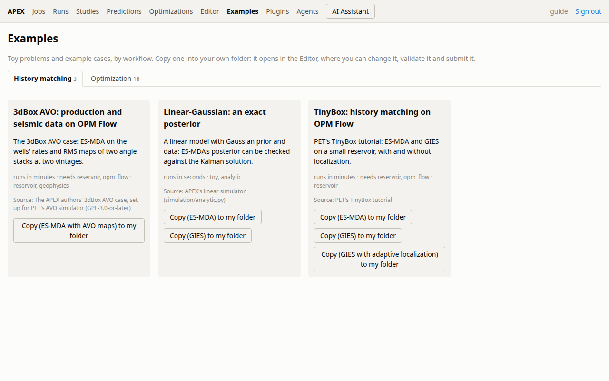

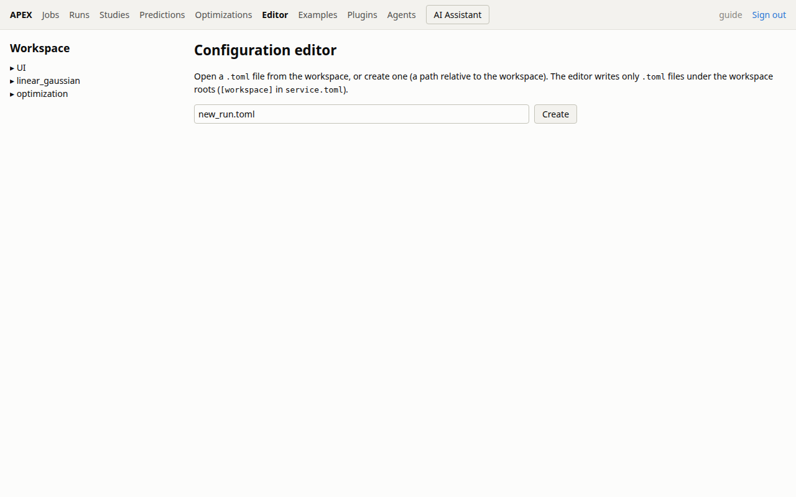

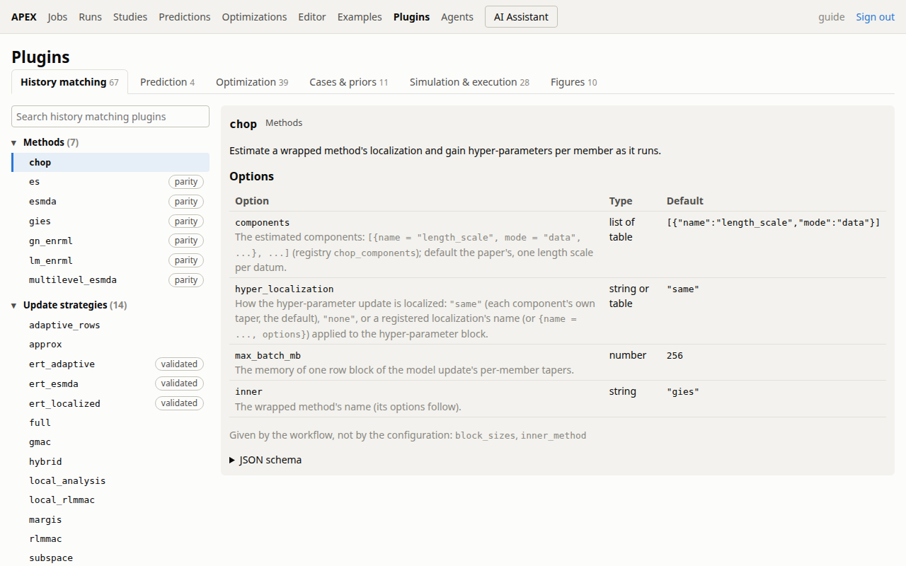

The picture above was taken with some optional add-on packages installed, so its tab counts may be a little higher than the plugin counts on your own `plugins` page. A plugin from an add-on appears only once that add-on is installed.

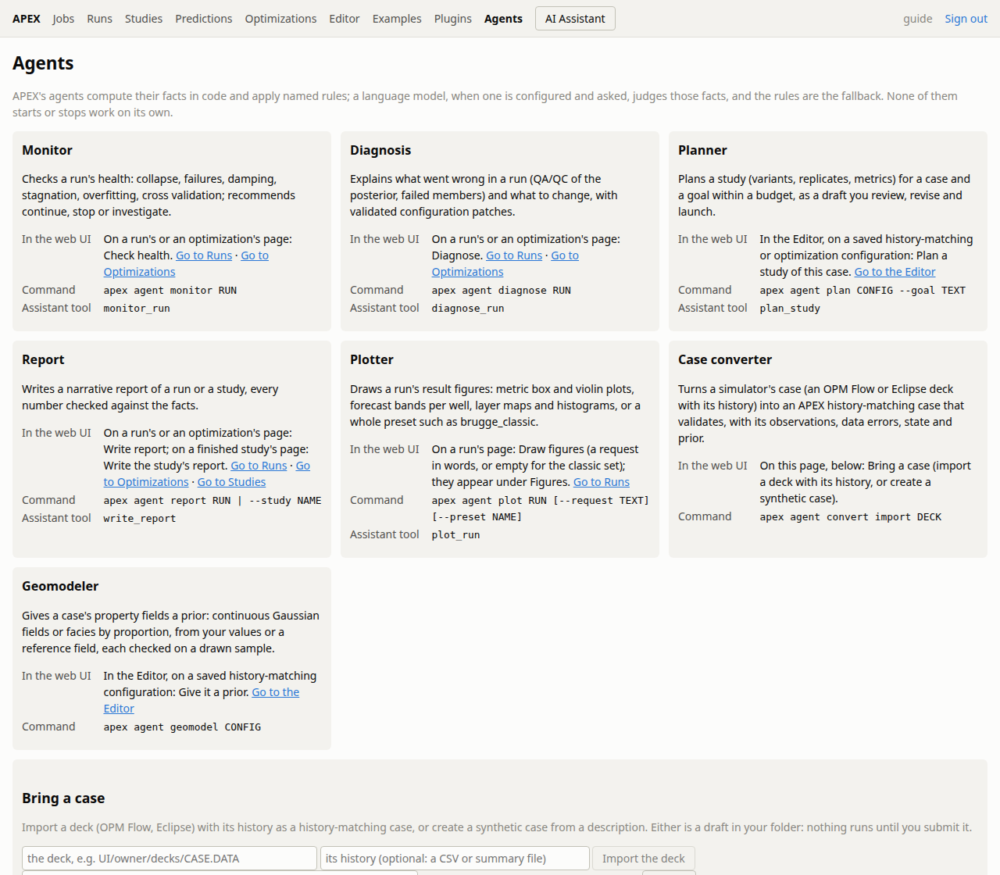

### Following work in progress

| Page | Route | What it shows |
|---|---|---|
| `jobs` | `#/jobs` | Every job you submitted from the web UI (the editor's submit, the assistant's launches): its kind, state, progress and when it ran. Open one to follow it. |
| `job` | `#/jobs/{job}` | One job's live events and progress, with Stop and Resume, and links to its runs. |

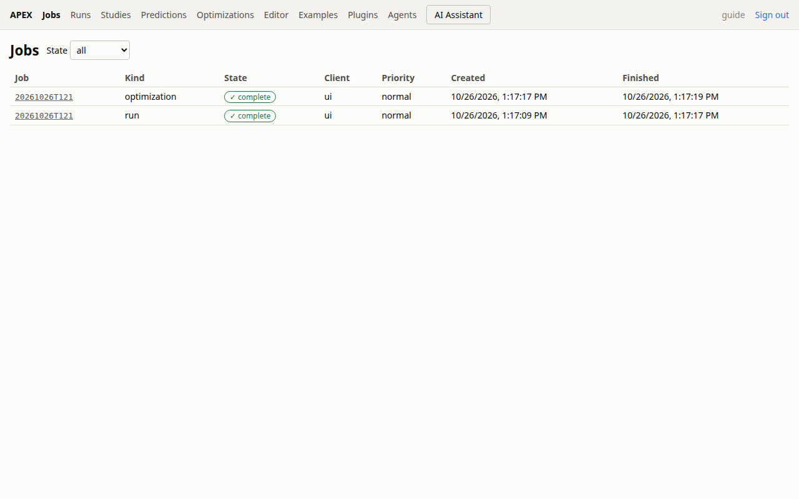

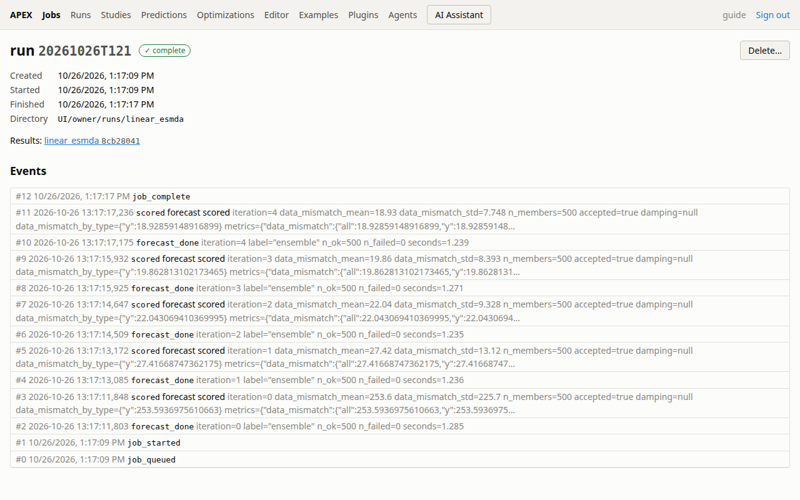

### Looking at results

| Page | Route | What it shows |
|---|---|---|
| `runs` | `#/runs` | The runs you can see, filterable by annotation, with their method and state. |
| `run` | `#/runs/{run}` | One run's summary and its performance metrics at every step, as charts. |
| `optimizations` | `#/optimizations` | Your optimizations and their state. |
| `optimization` | `#/optimizations?path={optimization}` | One optimization's objective over its steps, and its front with several objectives. |
| `studies` | `#/studies` | Your studies and their state. |
| `prediction` | `#/prediction` | A prediction's percentiles and forecast scores. |

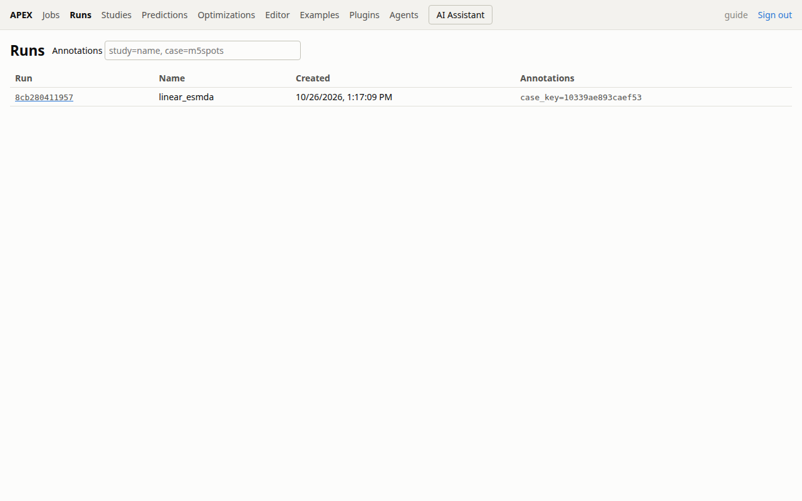

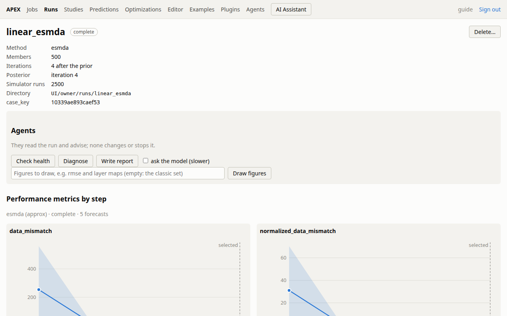

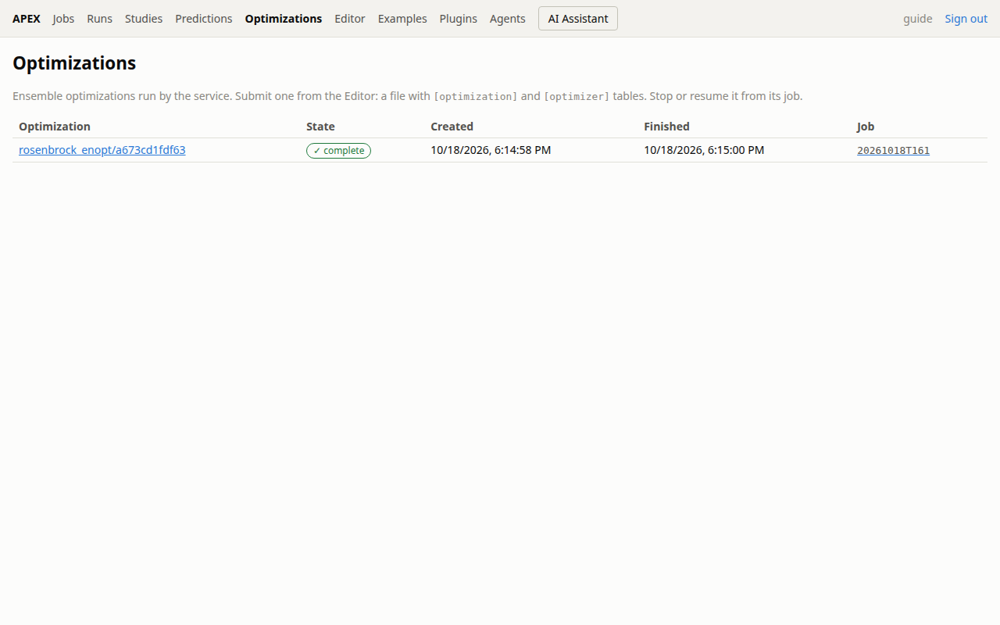

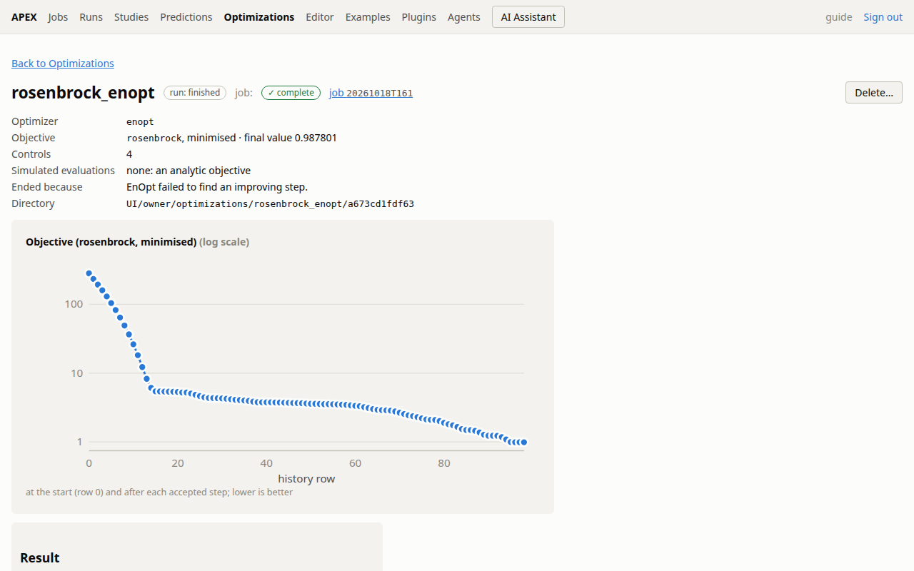

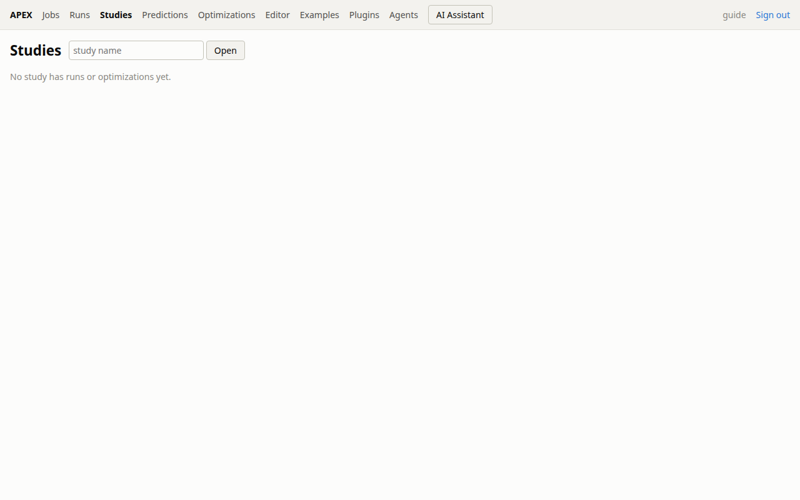

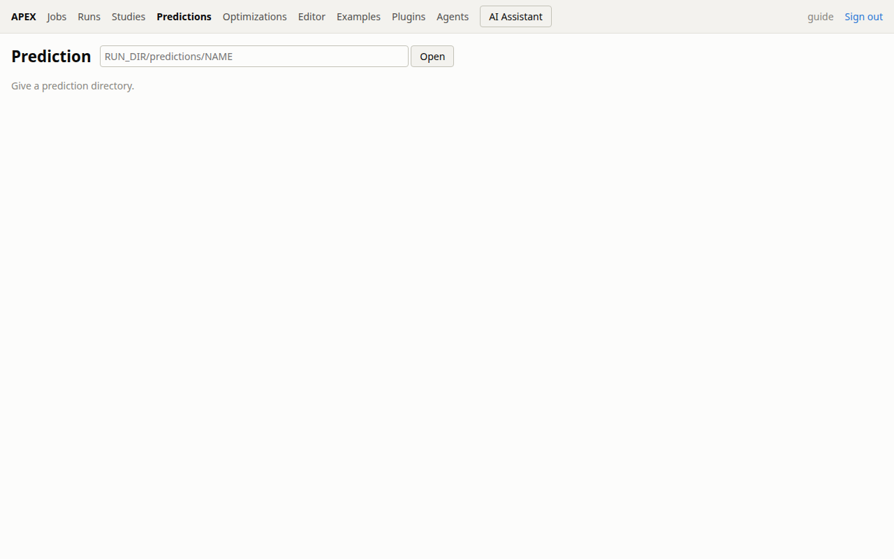

## Steps

1. Open the web UI in your browser and start at `examples` if you are new, or at `jobs` if you already have work going.
2. To configure something, use `examples` to copy a configuration into your workspace folder. The copy is then among the workspace's configurations that you can open in `editor`.
3. While editing, look up plugin names, options and defaults in `plugins` instead of guessing them. The same list is available in a terminal:

   ```bash
   uv run apex plugins --json
   ```

   Without `--json` it lists every plugin with its options; with `--json` you get full descriptions as JSON.
4. Validate the file before you rely on it. The `editor` page lets you validate a TOML file. You can also check a saved file from the terminal:

   ```bash
   uv run apex validate config.toml
   ```

   Replace `config.toml` with the path of your file. `apex validate` accepts a run, prediction, optimization, study or surrogate build configuration, reports any problem it finds, and plans the cost without simulating anything. Add `--json` to get the result as JSON, and `--root` to name the services root.
5. Start the work from the `editor`: save the file, then press *submit*. The service runs it as a job, whatever its kind. If the submission is large, the editor shows an `apex approve TOKEN` command instead of starting it: the submission is waiting for approval. Run that command (`uv run apex approve TOKEN`), then submit again.
6. Find your work in `jobs` and open it to reach `job`, where you can watch live events and progress.
7. From `job`, follow the links to its runs, then open a run in `run` to see its charts.
8. For other kinds of results, use `optimizations` (then `optimization`), `studies` and `prediction`.
   - The route of `prediction` has no item. Open the page at `#/prediction`; it shows a prediction's percentiles and forecast scores.
   - To inspect a prediction you made with `apex predict` from the terminal, give its directory to `apex report`, which accepts the directory of a run or of a prediction.

### Starting work from a terminal instead

Work started in a terminal does not show in `jobs`, but you may want it for scripts:

- `uv run apex run config.toml` runs a history match in that terminal, without a job. `--max-steps N` stops it after N analysis steps and `uv run apex resume RUN_DIR` continues it.
- `uv run apex submit config.toml` hands a run, prediction, optimization or surrogate build to the job service in the background. Useful options: `--wait` waits for the job to end, `--priority` takes `high`, `normal` (the default) or `low`, `--force-new` runs again even if an identical run exists, and `--annotation key=value` (repeatable) attaches an annotation. A large job asks for approval: `--yes` approves it without asking, or approve a token with `uv run apex approve TOKEN` and then pass it as `--approval-token TOKEN`.

## Worked example: from an example to a result

This example takes you from the catalogue to the charts of a history-matching run, in the browser: `examples` (copy) → `editor` (edit, validate, save, submit) → `jobs` → `job` → `run`. Only the optional last steps use a terminal.

1. Go to `#/examples` and pick an example under a **history-matching** workflow. Do not choose a prediction or a study example: the later steps follow a history-matching run. Use the example's copy control to copy it into your workspace folder.
2. Go to `#/editor`, and click the name of the file you just copied to open it. Now make one small, safe change. A good choice is an option that does not make the run bigger or longer, such as `energy` of the update strategy `full`:
   - Look in the file for the strategy section, `[method.strategy]`. If it names the `full` strategy, you can change `energy`. If it names another strategy, open `#/plugins`, find that strategy in the `update_strategies` registry and pick a plain number option from it instead.
   - On `plugins`, `energy` of `full` is a number in `(0, 1]` with default `0.98`: the fraction of the singular-value sum kept. Any value in that range keeps the run the same size.
   - If the `energy` line is already in the section, change its value; if not, add the line to the section.

   The relevant part of the file looks like this after the change (your file has other sections too, which you leave as they are):

   ```toml
   [method]
   name = "gies"
   max_iterations = 10

   [method.strategy]
   name = "full"

   [method.strategy.options]
   energy = 0.95
   ```

   Avoid options that set sizes, such as an ensemble size: a large value can make the run much longer. `full` only works with the methods `gies`, `lm_enrml` and `gn_enrml`; with `esmda` it is refused, so keep the strategy the example already uses if it is not `full`.

   You have done it right when the line uses the exact option name shown on `plugins` and the editor's validation (next step) reports no problem. Another option you will meet is `ensemble_file` of the `file` priors plugin: it is required, and it is the path of an `.npz` file with one array per variable.
3. Validate the file in the editor and fix anything it reports. Save the file when it validates.
4. With the saved file open in the editor, press *submit*. If the editor reports an error, fix the file, save it and submit again. If it shows an `apex approve TOKEN` command, run it as in step 5 above, then submit again. A refused submission does not appear in `jobs`.
5. Go to `#/jobs`. Each row shows a job's kind, state, progress and when it ran. A history-matching job has the kind `run`. Open `jobs` right after submitting; the row with kind `run`, some progress and a time within a few minutes of your *submit* is probably yours. Open it and read its live events: they should refer to the work you submitted. If the list is empty, look at the editor for an error from the previous step.
6. On the `job` page, watch the live events and the progress. How long a run takes depends on the example, so wait until the run links appear, or until the progress shows the job has ended, before you read the charts.
7. Optional: try Stop and Resume. Stop does not act at once: it asks the run to stop at its next checkpoint, so the run may keep working for a while. Keep watching the state shown on the `job` page until it shows the job is no longer working; a slow stop is normal. Then press Resume to continue it from its last checkpoint, and wait until the state shows the job is working again. Use the buttons rather than `apex stop` and `apex resume` in a terminal: a run resumed from a terminal runs there, outside the job, and the web UI no longer follows it.
8. Follow the links from the job to a `run` page. The links may not be there at the start; if the live events keep moving, wait and check again after some analysis steps have finished. If the job has stopped or failed and still shows no run links, read the last live events and the error on the `job` page. On the `run` page, look at the charts of the performance metrics and find the data mismatch: for a finished run it should go down from the first step to the last. If it does not, check the events for warnings, and print the mismatch history with `apex report` (below) to read the numbers.
9. To see all the runs you can see, go to `#/runs`. The list shows each run's method and state. Open an entry to reach its `run` page.
10. Optional, in a terminal: for a written overview, run from the APEX folder:

    ```bash
    uv run apex summary RUN_DIR --output report.md --title "My run"
    ```

    `RUN_DIR` can be one or more run directories, or a folder that holds runs, which `apex summary` searches. It reports every metric at every step. The Markdown goes to `report.md` and a CSV file is written next to it. Without `--output` the Markdown is printed; without `--title` the title is "Results summary".
11. Optional, in a terminal: print the data mismatch history and performance metrics of one run, and write its figures:

    ```bash
    uv run apex report RUN_DIR --plots
    ```

    `RUN_DIR` is the directory of a run or of a prediction. `--plots` also writes the result figures as PNG and PDF, into `RUN_DIR/report` unless you give `--output`. Use `--font-size` to change the font size of the figures.

## Pitfalls

- **Empty lists.** `jobs`, `runs`, `optimizations` and `studies` only show what you submitted through the web UI or can see. An empty list usually means nothing has been submitted yet, or the submission was refused. Work started in a terminal (`apex run`, `apex optimize`, `apex submit`) is not shown in `jobs`.
- **A submission waiting for approval.** It does not run until `apex approve TOKEN` has been run; submit again afterwards.
- **Runs that disappear.** `apex gc` forgets runs whose folder is gone and prunes what the service keeps. With `--chats` and `--guests` it also applies the chat history's and the guests' limits, and with `--code` it removes old frozen copies of APEX. Its `--dry-run` switch only has an effect together with `--code`, where it lists what would go and removes nothing.
- **Starting work from a terminal.** `apex run` runs in the terminal, not as a job of the service, so the web UI never shows it. Submit from the `editor` to follow work in the web UI.
- **Pages that need an item.** `job`, `run` and `optimization` describe a single item, so open them from their list page instead of typing a route by hand.
- **Wrong example type.** The worked example follows a history-matching run. A prediction or study example gives another kind of job.
- **Wrong folder or command in the terminal.** `apex` is not on the PATH, so type `uv run apex ...` from the APEX folder.
- **Saving without validating.** Validate before you submit anything, so mistakes show up early.
- **Guessing option names.** Check `plugins` for the exact names, types and defaults.
- **A strategy that does not fit the method.** `full` is refused by `esmda`; use it with `gies`, `lm_enrml` or `gn_enrml`.
- **Examples are copies.** `examples` copies a configuration into your workspace folder. Edit your copy, not the catalogue.
- **Stop is not instant.** A run stops at its next checkpoint, so it may keep going for a while after you ask. A stopped run can be continued with Resume on its `job` page.
- **Run directories for the terminal commands.** `apex stop`, `apex resume` and `apex report` need the directory of a run (`apex report` also accepts a prediction's). Only `apex summary` searches folders.

## What to read next

- The lessons on writing and validating a TOML configuration, to get more from `editor`.
- The lessons on plugins and their options, alongside the `plugins` page.
- The lessons on running work and following jobs, to go deeper on `jobs` and `job`, and on finding run directories.
- The lessons on optimizations, studies and predictions, to start them and to read `optimization`, `studies` and `prediction` with confidence.
