# The web UI

## Goal

By the end of this lesson you will know what each page of the APEX web UI shows, how to move between the pages, and how to follow a piece of work from an example configuration to its results.

## Prerequisites

- A running APEX web UI that you can open in your browser.
- Nothing else is needed for the main path: the worked example below is done entirely in the browser. The `examples` page gives you a first configuration.
- Optionally, a terminal where the `apex` command is available. It is only for the steps marked optional, which you can skip on a first read. Check with `apex --help`. If the command is not found, ask whoever set up APEX for you.
- Work is started from the web UI itself (the `editor` page's *submit*). The web UI shows only what was submitted through it. A run started in a terminal with `apex run` is not a job, and `apex submit` from a terminal is not listed either, because the `jobs` page lists only jobs you submitted from the web UI.

The pages `jobs`, `runs`, `optimizations` and `studies` list only what you submitted or can see, so they are empty until work has been submitted.

## Words used on this page

- **Services root**: the folder where APEX keeps its service data, including the record of your jobs. The default is `$APEX_HOME` if that variable is set, else `~/.apex/service`.
  - To see what your terminal uses, run `echo "$APEX_HOME"`. If it prints a path, that path is the root. If it prints nothing (an empty line), the variable is unset and the default applies.
  - The web UI's root is chosen by whoever set it up. Ask them for it, and make sure `APEX_HOME` has the same value in your terminal (or is unset in both).
  - The commands `apex submit`, `apex validate`, `apex study compare`, `apex approve` and `apex gc` accept `--root` to name the root; without it they take `$APEX_HOME`, else the default.
- **Workspace folder**: the folder that holds your configurations. The `editor` page lists the configurations in it, and `examples` copies files into it. To run terminal commands on a saved file you need the file's path on disk. If you do not know where the workspace folder is, ask whoever set up the web UI.
- **Workflow**: the kind of work a configuration is for, for example a history-matching run or a prediction. The `examples` page groups its catalogue by workflow, so the heading you find an example under is its workflow. The `plugins` page also groups plugins by workflow.
- **Registry**: a named group of plugins within a workflow, as the `plugins` page shows them. To find a plugin from your example, look in your example's workflow and scan its registries for the name.
- **History-matching run**: a run that adjusts an ensemble of models so that it matches observed data. It proceeds in **analysis steps**. `apex run` starts one in your terminal.
- **Data mismatch**: how far the simulated results are from the observed data. A run is doing its job when the mismatch goes down from step to step.
- **Checkpoint**: a point where a run can be stopped and later continued.
- **Run directory**: the directory of one run. The commands `apex stop`, `apex resume` and `apex report` take it as an argument. `apex summary` also accepts a folder that holds runs, and searches that folder. The web UI does not need you to know it. If you want to use the terminal commands, ask whoever set up the web UI which folder holds your runs; otherwise skip the optional steps.
- **Prediction**: a forecast of the ensembles of a history-matching run beyond the history. `apex predict` makes one.
- **Optimization**: work that improves an objective over several steps. `apex optimize` runs one in a terminal. An optimization configuration can list several objectives in its `optimization:objectives` entry, each a plugin with options and an optional label. The `optimization` page shows the objective over its steps, and its front when there are several objectives.
- **Study**: a set of variants that you compare. `apex study compare NAME` compares a study's variants at each run's posterior. The `studies` page lists your studies and their state. `apex validate` accepts a study configuration.
- **Job**: a unit of submitted work. It has a kind, a state and progress.

How to configure and start optimizations and studies is covered in later lessons. `apex summary` already reports optimization steps.

## How the UI is organised

Every page has its own route, written after a `#` in the address bar. For example, the list of jobs is at `#/jobs`. Some pages describe one specific item (a job, a run, an optimization). You reach those by opening an entry from the matching list page, and the UI fills in the item for you (the `{job}`, `{run}` and `{optimization}` parts of the routes below).

The `optimization` route looks different from the others: it ends in `?path={optimization}`. The UI fills in the `path` value. You never need to type it. Open the entry from `optimizations` instead.

### Setting up and configuring

| Page | Route | What it shows |
|---|---|---|
| `examples` | `#/examples` | The examples catalogue by workflow. Copy one into your workspace folder. |
| `editor` | `#/editor` | The workspace's configurations. Open, edit, validate and save a TOML file. |
| `plugins` | `#/plugins` | Every plugin by workflow and registry, with its options and their defaults. |
| `agents` | `#/agents` | APEX's public agents: what each does and how to run it from the web UI. |

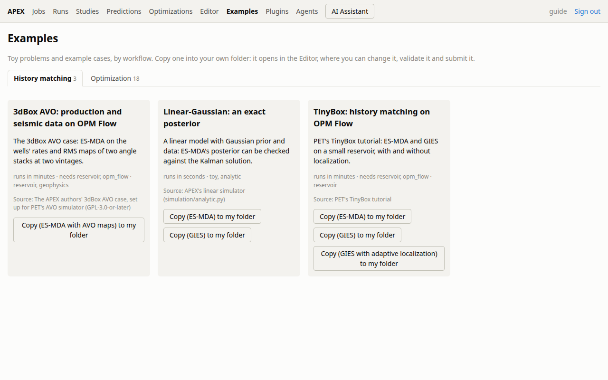

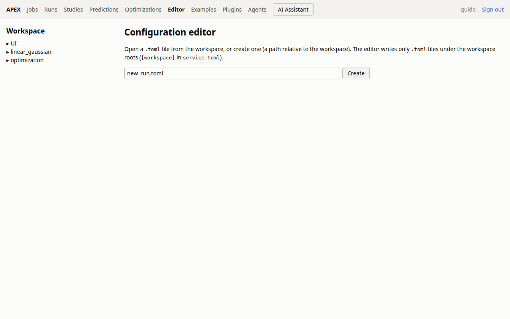

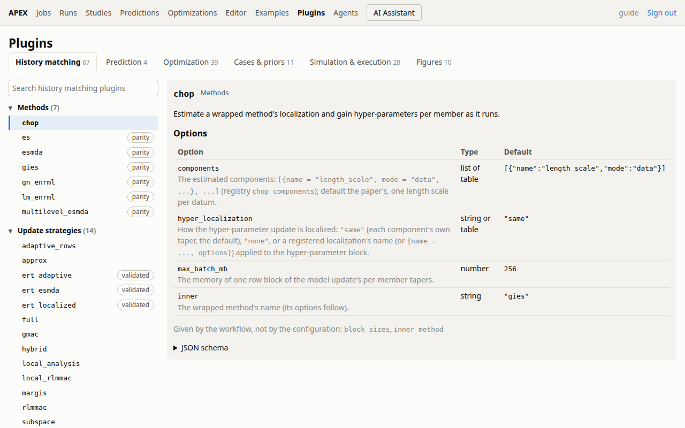

The picture was taken with APEX's optional extras installed, so its tabs count a few more plugins than a default `uv sync --locked` lists: an extra's plugins appear once it is installed.

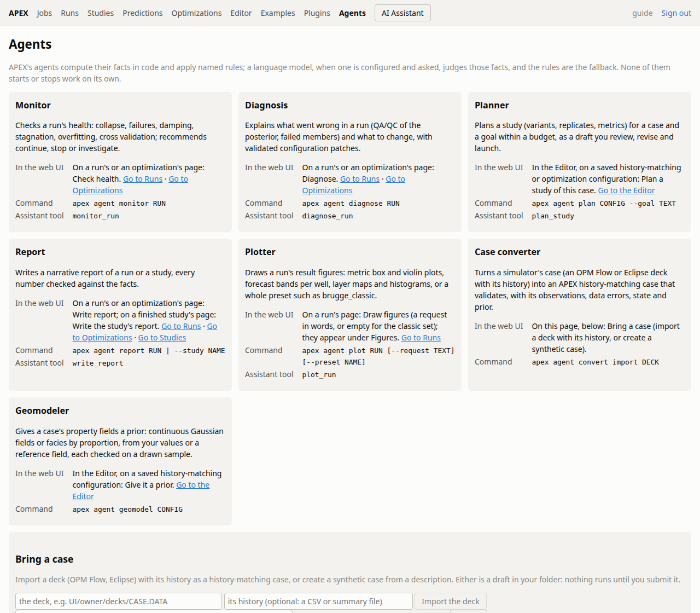

### Following work in progress

| Page | Route | What it shows |
|---|---|---|
| `jobs` | `#/jobs` | Every job you submitted from the web UI: its kind, state, progress and when it ran. Open one to follow it. |
| `job` | `#/jobs/{job}` | One job's live events and progress, with Stop and Resume, and links to its runs. |

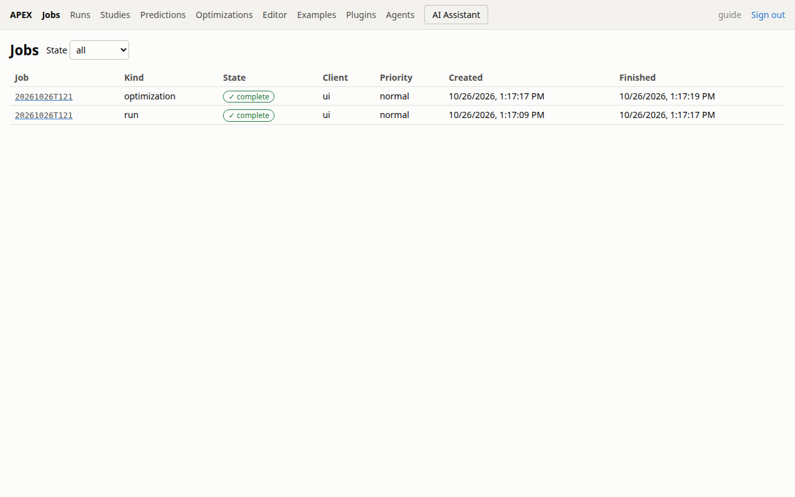

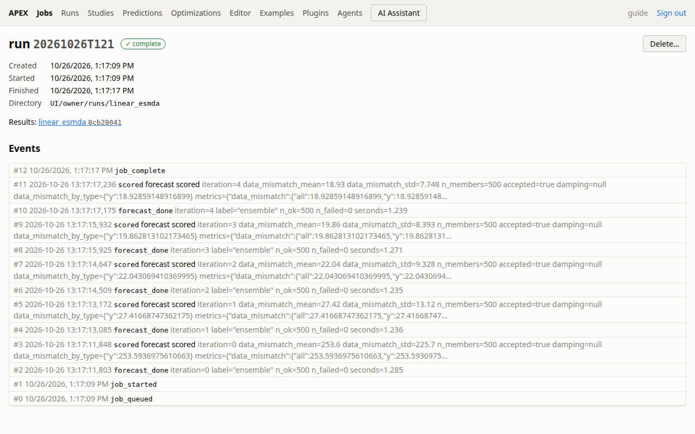

### Looking at results

| Page | Route | What it shows |
|---|---|---|
| `runs` | `#/runs` | The runs you can see, filterable by annotation, with their method and state. |
| `run` | `#/runs/{run}` | One run's summary and its performance metrics at every step, as charts. |
| `optimizations` | `#/optimizations` | Your optimizations and their state. |
| `optimization` | `#/optimizations?path={optimization}` | One optimization's objective over its steps, and its front with several objectives. |
| `studies` | `#/studies` | Your studies and their state. |
| `prediction` | `#/prediction` | A prediction's percentiles and forecast scores. |

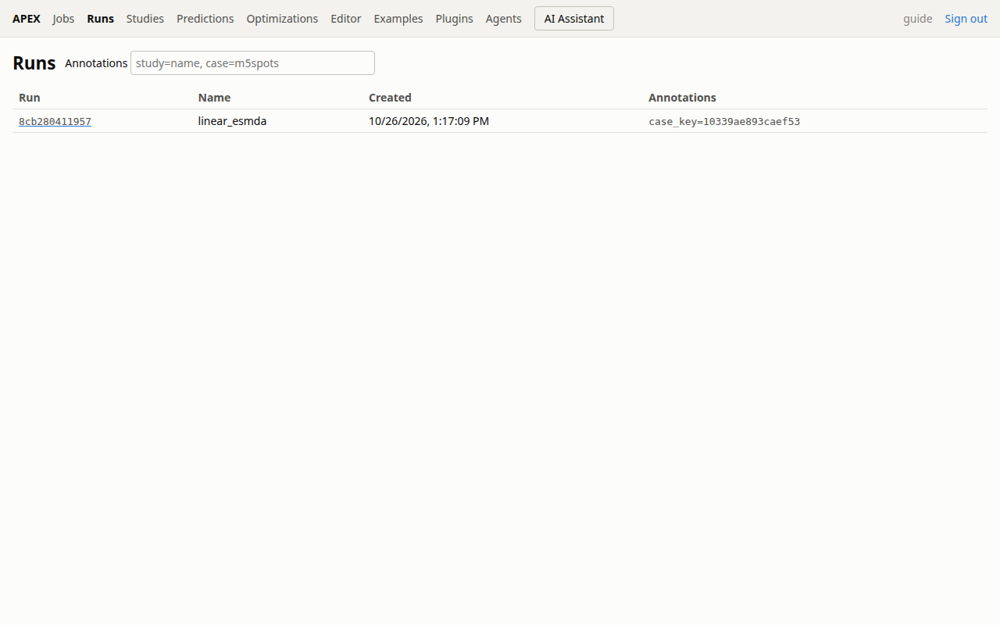

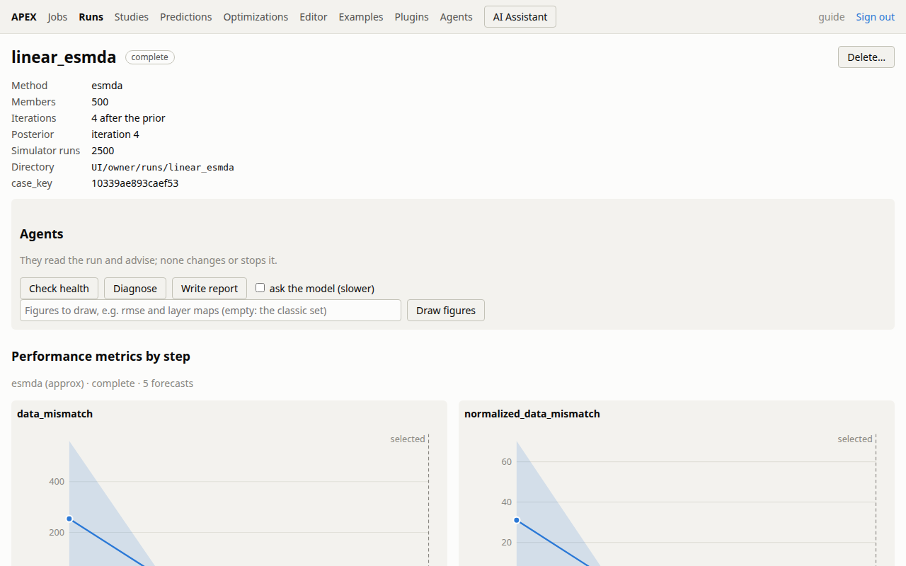

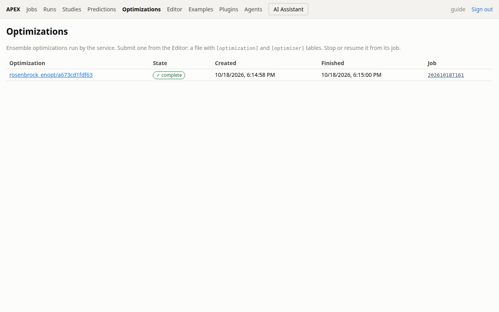

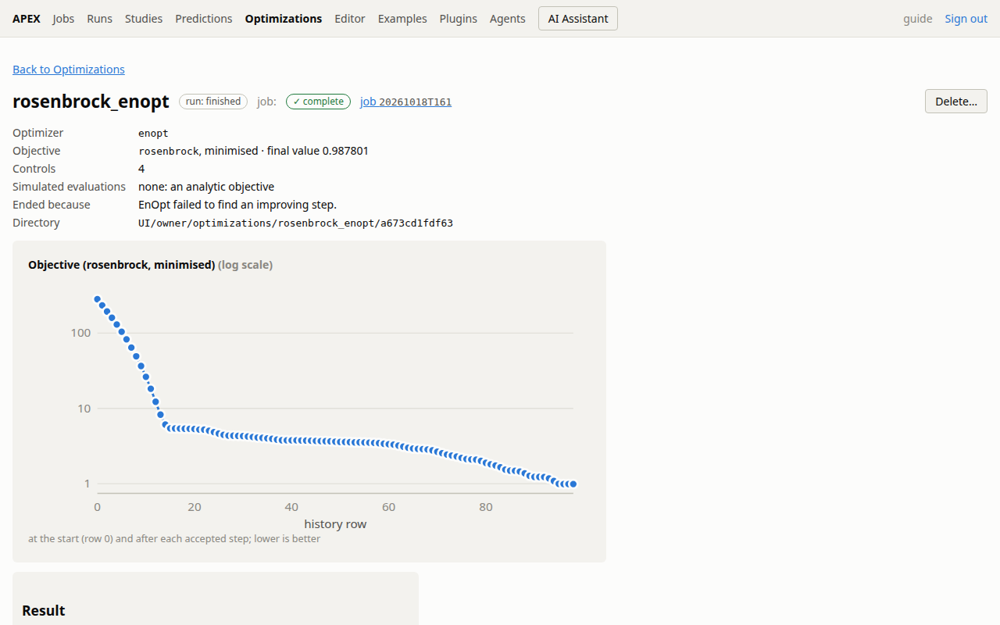

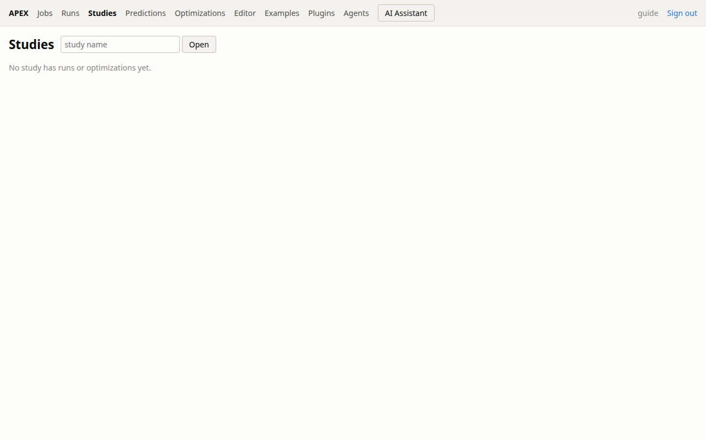

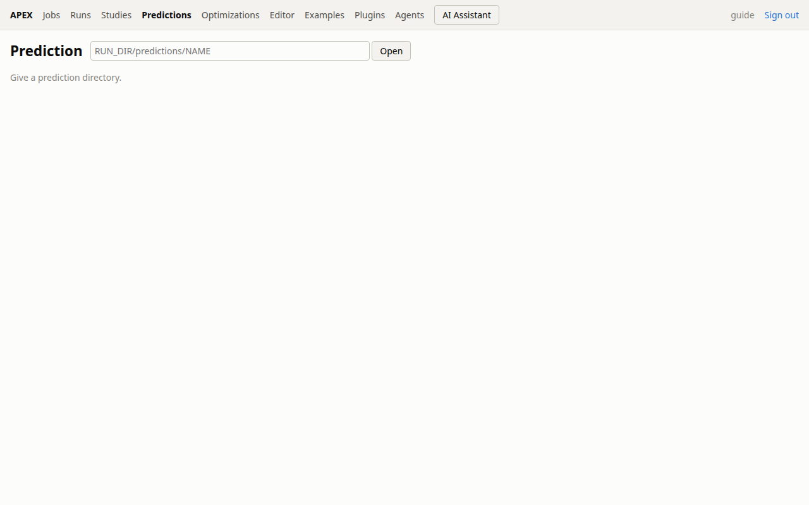

## Steps

1. Open the web UI in your browser and start at `examples` if you are new, or at `jobs` if you already have work going.
2. To configure something, use `examples` to copy a configuration into your workspace folder. The copy is then among the workspace's configurations that you can open in `editor`.
3. While editing, look up plugin names, options and defaults in `plugins` instead of guessing them. The same list is available on the command line with `apex plugins` (add `--json` for full descriptions as JSON).
4. Validate the file before you rely on it. The `editor` page lets you validate a TOML file. You can also check a saved file from the command line: first `cd` to the workspace folder (or use the file's full path), then run `apex validate config.toml`. It validates a run, prediction, optimization or study configuration, reports any problem it finds, and plans the cost without simulating anything. Add `--json` to get the result as JSON.
5. Start the work from the `editor`: save the file, then press *submit*. The service runs it as a job, whatever its kind (a history-matching run, a prediction, a study or an optimization). Above the service's approval limits, the editor shows an `apex approve TOKEN` command. It is meant for the person who runs the service, on the service's machine: send them the command the editor shows. Once it has been approved, submit again. (In a terminal, `apex run config.toml` runs a history match in that terminal, without a job, and `apex submit config.toml` hands a configuration to the job service in the background. Neither appears in the web UI; use them for work you follow from the terminal.)
6. Find your work in `jobs` and open it to reach `job`, where you can watch live events and progress.
7. From `job`, follow the links to its runs, then open a run in `run` to see its charts.
8. For other kinds of results, use `optimizations` (then `optimization`), `studies` and `prediction`.
   - The route of `prediction` has no item, so you cannot pick a prediction by typing a route. Open the page at `#/prediction`; it shows a prediction's percentiles and forecast scores.
   - To inspect a prediction you made with `apex predict` from the terminal, give its directory to `apex report`, which accepts the directory of a run or of a prediction.

## Worked example: from an example to a result

This example takes you from the catalogue to the charts of a history-matching run, all in the browser: `examples` (copy) → `editor` (edit, validate, save, submit) → `jobs` → `job` → `run`. Only the optional last steps use a terminal.

1. Go to `#/examples` and pick an example under a **history-matching** workflow. Do not choose a prediction or a study example: the later steps follow a history-matching run, and would not match. Note the workflow heading you found it under. Copy the example into your workspace folder.
2. Go to `#/editor` and open the copied file. Choose one option to change:
   - Read through the file and note the name of a plugin it mentions.
   - Open `#/plugins` and look for that name in the same workflow as your example, scanning the registries listed there.
   - Pick one option of that plugin and note its exact name, its type and its default.
   - Back in the file, find the part that sets that plugin's options, where the plugin name and its option lines appear together. A TOML option line has the form `option_name = value`. If your option is already there, change its value. If not, add a line for it in that same part. Use a value different from the default and of the same type (a number where the default is a number, for example). The exact plugin and option depend on the example you copied, so copy the spelling from the `plugins` page.
3. Validate the file in the editor and fix anything it reports. Save the file when it validates.
4. With the saved file open in the editor, press *submit*. If the editor reports an error, fix the file, save it and submit again. If it shows an `apex approve TOKEN` command, the submission needs approval: send that command to the person who runs the service, and submit again once they have approved it. A submission that was refused will not appear in `jobs`.
5. Go to `#/jobs`. Each row shows a job's kind, state, progress and when it ran. To avoid mixing your job up with others, start one piece of work at a time and open `jobs` right after submitting it. Look for a row of the kind run that is queued or in progress, and compare its time with when you pressed *submit*. Open it and read its live events: they should refer to the work you submitted. If the row is not yours, go back and open another row of the same kind. If the list is empty, look at the editor for an error from the previous step.
6. On the `job` page, watch the live events and the progress. The live events are the messages the job reports as it works, and the progress shows how far it has come. Leave the run going for now: stopping is an optional side trip, and the next step needs a run that is working or finished.
7. Optional: try Stop and Resume. Stop does not act at once: it asks the run to stop at its next checkpoint, so keep watching the state on the `job` page (or in `jobs`) until it shows the job has stopped. How long that takes depends on the run. Once it has stopped, press Resume to continue it from its last checkpoint, and wait until the job is running again before you go on. Use the buttons rather than `apex stop` and `apex resume` in a terminal: a run resumed from a terminal runs there, outside the job, and the web UI no longer follows it.
8. Follow the links from the job to a `run` page. The links may not be there at the start. If the live events keep moving and the progress advances, the job is working, so wait and check the links again after some analysis steps have finished. If the job has stopped or failed and still shows no run links, read the last live events and the error on the `job` page for the cause. The charts show the run's performance metrics at every step. For a finished run you should see them covering all its analysis steps, and the data mismatch should have gone down from the first step to the last.
9. To see all the runs you can see, go to `#/runs`. The list shows each run's method and state. Open an entry to reach its `run` page.
10. Optional, in a terminal, once you know where your runs are kept (see *Run directory* above): for a written overview, run for example:

    ```bash
    uv run apex summary RUN_DIR --output report.md --title "My run"
    ```

    `RUN_DIR` can be one or more run directories, or a folder that holds runs, which `apex summary` searches. It reports every metric at every step. The Markdown goes to `report.md` and a CSV file is written next to it, in the same folder. Without `--output` the Markdown is printed to the terminal; without `--title` the title is "Results summary".
11. Optional, in a terminal, once you know the run directory: `apex report RUN_DIR` prints the data mismatch history and performance metrics of a run. It needs the directory of one run, or of a prediction, and does not search folders. Add `--plots` to also write the result figures as PNG and PDF, into `RUN_DIR/report` unless you give `--output`. Use `--font-size` to change the font size of the figures. The charts on the `run` page show the same kind of information without a terminal.

## Pitfalls

- **Empty lists.** `jobs`, `runs`, `optimizations` and `studies` only show what you submitted through the web UI or can see. An empty list usually means nothing has been submitted yet, or the submission was refused. Work started in a terminal (`apex run`, `apex optimize`, `apex submit`) is not shown in `jobs`.
- **Runs that disappear.** `apex gc` forgets runs whose folder is gone and prunes what the service keeps. Its `--dry-run` switch only has an effect together with `--code`, where it lists what would go and removes nothing. Ask whoever runs the service before using `apex gc` yourself.
- **Starting work from a terminal.** `apex run` runs in the terminal, not as a job of the service, so the web UI never shows it. Submit from the `editor` to follow work in the web UI.
- **Pages that need an item.** `job`, `run` and `optimization` describe a single item, so open them from their list page instead of typing a route by hand.
- **Wrong example type.** The worked example follows a history-matching run. A prediction or study example gives another kind of job.
- **Wrong folder in the terminal.** When you run `apex validate config.toml`, the relative path only works from the folder that holds the file. Use `cd` to go to the workspace folder first, or give the full path.
- **Saving without validating.** Validate before you submit anything, so mistakes show up early.
- **Guessing option names.** Check `plugins` for the exact names, types and defaults.
- **Examples are copies.** `examples` copies a configuration into your workspace folder. Edit your copy, not the catalogue.
- **Stop is not instant.** A run stops at its next checkpoint, so it may keep going for a while after you ask.
- **Stopping is not losing.** A stopped run can be continued with Resume on its `job` page.
- **Folders only for `apex summary`.** `apex stop`, `apex resume` and `apex report` need the directory of one run.

## What to read next

- The lessons on writing and validating a TOML configuration, to get more from `editor`.
- The lessons on plugins and their options, alongside the `plugins` page.
- The lessons on running work and following jobs, to go deeper on `jobs` and `job`, and on finding run directories.
- The lessons on optimizations, studies and predictions, to start them and to read `optimization`, `studies` and `prediction` with confidence.
